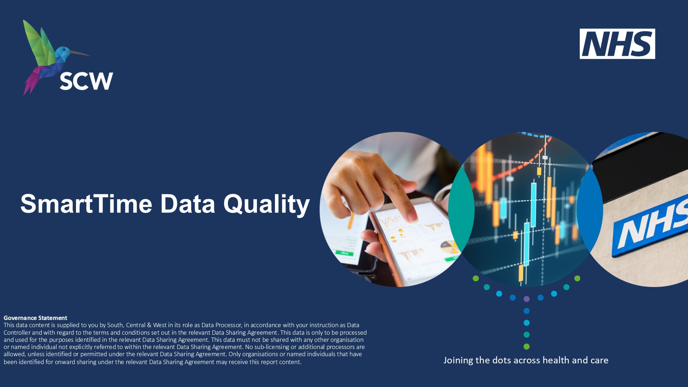
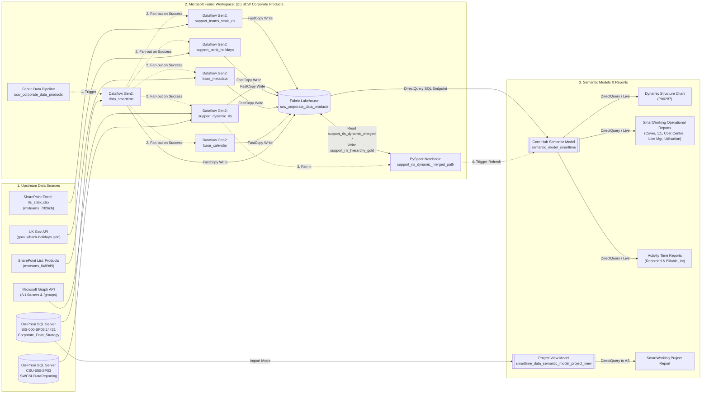

# SCW Corporate Data Products (`scw-corporate-data-products`)

End-to-end **Microsoft Fabric** & **Power BI Project (PBIP)** repository for **NHS South, Central and West Commissioning Support Unit (SCW CSU)** corporate data products, powering the **SmartTime Data Quality & Operational Reporting Suite (`P00278` / `DI1060.10`)** and the **Dynamic Structure Chart (`P00287`)**.



---

## 1. Product Catalogue (SharePoint Registry)

Metadata is synchronised directly from the SCW Products SharePoint list (`https://nhs.sharepoint.com/sites/msteams_8489d9/` $\rightarrow$ `Products` list, items `404` & `426`):

| Product Ref | SharePoint ID (Legacy ID) | Full Product Name | Product Owner | Primary Developer (Author) | Version & Release Date | Refresh Frequency | Data Governance / SLA | Power BI App Link |
| :--- | :--- | :--- | :--- | :--- | :--- | :--- | :--- | :--- |
| **`P00278`** (`DI1060.10`) | `404` (`209`) | **P00278 - SmartTime Data Quality Report (Power BI - Cloud)** | **Lisa Buck** | Bruno Alves de Sousa (`bi analytics`) | `v1.0.0` (legacy `1.1`) · Released `04/03/2026` (Created `11/02/2025`) | **Daily** | Official · IG Agreements · `non sla` (`SCW Internal`) | [Open in Power BI App](https://app.powerbi.com/groups/me/apps/d511ad50-eb9e-4b9c-a30a-51aece750057/reports/6c808620-b8a5-4f9f-8b1a-280f1974c8e8/ReportSection49041cdbb730ba8c3bc8?ctid=4088bef3-a7fb-4b63-b87b-4d8eda09b28d&experience=power-bi) |
| **`P00287`** | `426` (`224`) | **P00287 - Dynamic Structure Chart (Power BI - Cloud)** | **Paul Toomer** | Bruno Alves de Sousa (`bi analytics`, Created by Vicky Spark `08/08/2025`) | `v1.0` · Released `12/01/2026` | **Hourly** | Official · Public · `non sla` | [Open in Power BI App](https://app.powerbi.com/groups/me/apps/d511ad50-eb9e-4b9c-a30a-51aece750057/reports/01b658af-ef23-492f-afcc-9173de31817b/831a270680c8edd96dcd?experience=power-bi) |

* **`P00278` Official Registry Description:** *"SCW SmartTime Data Quality dashboards provide real-time insights into timesheet completion, project activity, and staff utilisation. Various views allow managers to monitor submissions, track project time, and analyse resource allocation against business categories."*
* **`P00287` Official Registry Description:** *"Dynamic structure chart in Power BI. Instantly explore the organisational structure of SCW, with clear view of line management and how teams connect through a live interactive organisation chart that expands with a click."*

---

## 2. High-Level System Architecture



---

## 3. Handover Documentation Index

This repository includes a complete handover documentation suite in [`docs/`](docs/) designed so an incoming developer or BI engineer with zero prior context can maintain, troubleshoot, and extend the platform:

1. **[Architecture & Data Lineage (`docs/01-architecture-and-data-lineage.md`)](docs/01-architecture-and-data-lineage.md)**
   * Full inventory of Fabric workspace identifiers, Lakehouse SQL endpoints, Data Pipelines, Dataflows Gen2 (`.pqt` / `.pq`), PySpark Notebook logic, and upstream source systems.
2. **[Semantic Models, Reports & DAX Dictionary (`docs/02-semantic-models-and-dax-dictionary.md`)](docs/02-semantic-models-and-dax-dictionary.md)**
   * Detailed breakdown of the hub-and-spoke semantic model design, table schemas, relationships, every DAX measure and calculated column, and the 10 Power BI report packages.
3. **[Security & Row-Level Security (RLS) Guide (`docs/03-security-and-rls-guide.md`)](docs/03-security-and-rls-guide.md)**
   * Deep dive into both Static RLS (`teams_rls_static` via SharePoint Excel) and Dynamic Hierarchy RLS (`vw_StaffHierarchy` + Entra ID + manual overrides in `support_rls_dynamic_missing` + PySpark `OrgPath` generation + `PATHCONTAINS` DAX security rules).
4. **[Operations & Handover Runbook (`docs/04-operations-and-handover-runbook.md`)](docs/04-operations-and-handover-runbook.md)**
   * **Mandatory Handover Checklist** (re-binding personal connections/credentials), routine operational tasks, on-demand pipeline triggers, and troubleshooting playbooks.

---

## 4. Repository Layout

```text
├── dataflows/                                   # Fabric Dataflow Gen2 templates (.pqt) & extracted Power Query (.pq)
│   ├── base_calendar.pqt / .pq                  # Financial & standard calendar generator (from 2024-04-01)
│   ├── base_metadata.pqt / .pq                  # SharePoint 'Products' list metadata (IDs 404 & 426)
│   ├── data_smarttime.pqt / .pq                 # SmartTime + Oracle agency rates & staff cost exceptions
│   ├── support_bank_holidays.pqt / .pq          # UK Gov bank holidays API ingestion
│   ├── support_dynamic_rls.pqt / .pq            # Entra ID users/groups + vw_StaffHierarchy + missing staff overrides
│   └── support_teams_static_rls.pqt / .pq       # SharePoint Excel rls_static.xlsx ingestion
├── notebooks/
│   └── support_rls_dynamic_merged_path.ipynb    # PySpark notebook: leaver bridging, tiered fallback & OrgPath -> support_rls_hierarchy_gold
├── visuals/
│   └── scw-org-chart/                           # Custom Power BI Org Chart visual (.pbiviz + TypeScript source)
├── pipelines/                                   # Fabric Data Pipeline ARM/JSON definitions & SVG manifests
│   ├── scw_corporate_data_products/             # Main scheduled E2E orchestration pipeline
│   ├── metadata update (on demand)/             # On-demand SharePoint metadata + semantic model refresh
│   └── static_rls_update (on demand)/           # On-demand static RLS Excel + semantic model refresh
├── docs/                                        # Comprehensive Handover & Technical Documentation
├── assets/                                      # Report cover images & visual assets
└── fabric/                                      # Power BI Projects (.pbip), Reports (.Report), and Semantic Models (.SemanticModel)
    ├── semantic_model_smarttime.*                   # Core Hub Semantic Model (.SemanticModel) & authoring report (.Report / .pbip)
    ├── smarttime_data_semantic_model_project_view.* # Project-level Import Semantic Model & authoring report
    ├── dynamic_structure_chart.*                    # P00287 Dynamic Structure Chart composite model & report
    ├── smartworking_operational_report_*            # P00278 Operational report suite (cover, 121_compliance, directorate_costcentre, line_manager, project, utilisation)
    ├── Activity Time Recorded.*                     # Thin report bound to semantic_model_smarttime (all recorded time w/ comments)
    └── Activity Time Billable_Int.*                 # Thin report bound to semantic_model_smarttime (billable/internal time w/ comments)
```

---

## 5. Quick Start for Developers

### Prerequisites
* **Power BI Desktop** (with **Power BI Project `.pbip`** and **TMDL** preview features enabled).
* **Tabular Editor 2/3** or **Power BI Modeling MCP** (for editing `.tmdl` definitions).
* Access to the Microsoft Fabric workspace **`[DI] SCW Corporate Products`** (`704dee3e-0fbd-4f0a-9f73-6165e7c95516`).

### Opening & Editing Reports Locally
1. Clone this repository.
2. Double-click any `.pbip` file to open the corresponding report and model in Power BI Desktop:
   * To edit **central measures, relationships, or RLS roles**, open [`fabric/semantic_model_smarttime.pbip`](fabric/semantic_model_smarttime.pbip) or edit the text files under [`fabric/semantic_model_smarttime.SemanticModel/definition/`](fabric/semantic_model_smarttime.SemanticModel/definition/).
   * To edit individual **operational report visuals**, open the respective `smartworking_operational_report_*.pbip`, [`fabric/dynamic_structure_chart.pbip`](fabric/dynamic_structure_chart.pbip), or `Activity Time *.pbip`.
3. Commit changes using [Conventional Commits](https://www.conventionalcommits.org/) (`type(scope): summary`) so TMDL and report JSON diffs remain clean and reviewable in Git.
