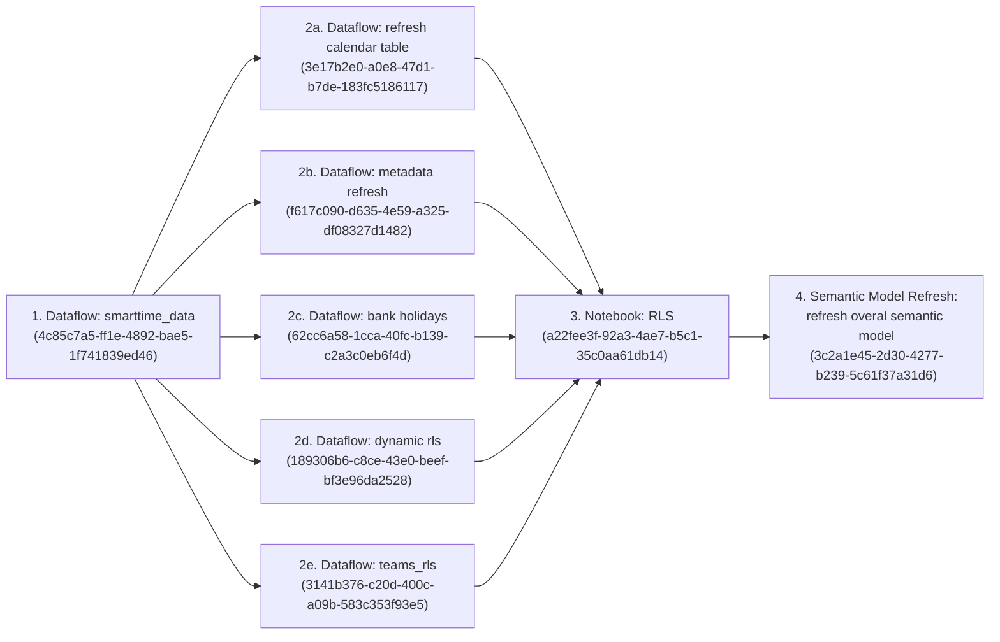

# 01 — Architecture & Data Lineage

This document details the end-to-end data architecture, upstream source connections, **Microsoft Fabric** orchestration pipelines, **Dataflow Gen2** transformations, **PySpark Notebook** hierarchy generation, and **Lakehouse** storage tables.

---

## 1. Environment & Platform Identifiers

| Resource Type | Name | Identifier / Endpoint | Notes |
| :--- | :--- | :--- | :--- |
| **Fabric Workspace** | `[DI] SCW Corporate Products` | `704dee3e-0fbd-4f0a-9f73-6165e7c95516` | Primary cloud workspace hosting pipelines, dataflows, lakehouse, and semantic models |
| **Fabric Lakehouse** | `scw_corporate_data_products` | SQL Endpoint: `6o7iqqh3u5ruxod3jwhnucnsru-h3xe24f5b4fe7h3tmfs6pskvcy.datawarehouse.fabric.microsoft.com` | Stores all staging and gold Delta tables in schema `dbo` |
| **Core Semantic Model** | `semantic_model_smarttime` | `3c2a1e45-2d30-4277-b239-5c61f37a31d6` | Hub model refreshed by all 3 Fabric pipelines |
| **Power BI App** | SCW Corporate Products App | `d511ad50-eb9e-4b9c-a30a-51aece750057` | Tenant ID (`ctid`): `4088bef3-a7fb-4b63-b87b-4d8eda09b28d` |
| **Report: P00278** | SmartTime Data Quality Report | `6c808620-b8a5-4f9f-8b1a-280f1974c8e8` | Published in App `d511ad50-eb9e-4b9c-a30a-51aece750057` |
| **Report: P00287** | Dynamic Structure Chart | `01b658af-ef23-492f-afcc-9173de31817b` | Published in App `d511ad50-eb9e-4b9c-a30a-51aece750057` |

---

## 2. Upstream Data Sources Inventory

| Source System | Server / URL | Database / Object | Consumed By Dataflow | Auth / Gateway Notes |
| :--- | :--- | :--- | :--- | :--- |
| **On-Prem SQL Server (SmartTime & Oracle)** | `BIS-000-SP05.bis.xswhealth.nhs.uk, 14431` | Database: `Corporate_Data_Strategy` Tables: • `dbo.Smart_Time` • `dbo.Oracle_Agency_cost_rates` • `dbo.Oracle_Staff_Cost_Exceptions` | [`dataflows/data_smarttime.pq`](../dataflows/data_smarttime.pq) (and `smarttime_data_semantic_model_project_view`) | Requires On-Premises Data Gateway access to `BIS-000-SP05` on port `14431`. |
| **On-Prem SQL Server (Staff Hierarchy)** | `CSU-000-SP03` | Database: `SWCSUDataReporting` View: `dbo.vw_StaffHierarchy` | [`dataflows/support_dynamic_rls.pq`](../dataflows/support_dynamic_rls.pq) | Requires On-Premises Data Gateway access to `CSU-000-SP03`. |
| **Microsoft Graph REST API** | `https://graph.microsoft.com/v1.0/` | • `/users?$top=999` • `/groups?$top=999` | [`dataflows/support_dynamic_rls.pq`](../dataflows/support_dynamic_rls.pq) | Uses recursive M function `GetPages` following `@odata.nextLink` to crawl all Entra ID users and groups. |
| **SharePoint Online (Product Registry)** | `https://nhs.sharepoint.com/sites/msteams_8489d9/` | SharePoint List: `Products` (`ApiVersion = 14`) • Item `Id = 404` (`P00278`) • Item `Id = 426` (`P00287`) | [`dataflows/base_metadata.pq`](../dataflows/base_metadata.pq) | Organisational OAuth2 account with read access to the SCW Product Registry SharePoint site. |
| **SharePoint Online (Static RLS Excel)** | `https://nhs.sharepoint.com/sites/msteams_7026cb-P00278SmartTimeDataQualityReporting/` | Path: `Shared Documents/P00278 SmartTime Data Quality Reporting/Supporting Docs/rls_static.xlsx` (Sheet: `rls_static`) | [`dataflows/support_teams_static_rls.pq`](../dataflows/support_teams_static_rls.pq) | Organisational OAuth2 account with read access to the P00278 Teams/SharePoint site. |
| **UK Government API** | `https://www.gov.uk/bank-holidays.json` | JSON feed (Index `0` — England & Wales events) | [`dataflows/support_bank_holidays.pq`](../dataflows/support_bank_holidays.pq) | Anonymous Web connection. |

---

## 3. Fabric Data Pipelines Orchestration

All pipeline definitions are stored under [`pipelines/`](../pipelines/).

### 3.1 Main Scheduled Pipeline: `scw_corporate_data_products`
* **Definition:** [`pipelines/scw_corporate_data_products/scw_corporate_data_products.json`](../pipelines/scw_corporate_data_products/scw_corporate_data_products.json)
* **Purpose:** Full end-to-end refresh of all Dataflows, the PySpark RLS Hierarchy Notebook, and the core `semantic_model_smarttime` dataset.

| Step | Activity Name | Activity Type | Target Fabric Object ID | Timeout / Retry Policy |
| :--- | :--- | :--- | :--- | :--- |
| **1** | `smarttime_data` | `RefreshDataflow` | `4c85c7a5-ff1e-4892-bae5-1f741839ed46` (`data_smarttime`) | Timeout `12h`, Retry `0` |
| **2a** | `refresh calendar table` | `RefreshDataflow` | `3e17b2e0-a0e8-47d1-b7de-183fc5186117` (`base_calendar`) | Timeout `12h`, Retry `0` |
| **2b** | `metadata refresh` | `RefreshDataflow` | `f617c090-d635-4e59-a325-df08327d1482` (`base_metadata`) | Timeout `12h`, Retry `0` |
| **2c** | `bank holidays` | `RefreshDataflow` | `62cc6a58-1cca-40fc-b139-c2a3c0eb6f4d` (`support_bank_holidays`) | Timeout `12h`, Retry `0` |
| **2d** | `dynamic rls` | `RefreshDataflow` | `189306b6-c8ce-43e0-beef-bf3e96da2528` (`support_dynamic_rls`) | Timeout `12h`, Retry `0` |
| **2e** | `teams_rls` | `RefreshDataflow` | `3141b376-c20d-400c-a09b-583c353f93e5` (`support_teams_static_rls`) | Timeout `12h`, Retry `0` |
| **3** | `RLS` | `TridentNotebook` | `a22fee3f-92a3-4ae7-b5c1-35c0aa61db14` (`support_rls_dynamic_merged_path`) | Timeout `12h`, Retry `0` |
| **4** | `refresh overal semantic model` | `PBISemanticModelRefresh` | `3c2a1e45-2d30-4277-b239-5c61f37a31d6` (`semantic_model_smarttime`) | Timeout `12h`, Retry `3` (`30s` interval), Transactional |

### 3.2 On-Demand Pipeline: `metadata update (on demand)`
* **Definition:** [`pipelines/metadata update (on demand)/metadata update (on demand).json`](../pipelines/metadata%20update%20(on%20demand)/metadata%20update%20(on%20demand).json)
* **Use Case:** Run manually whenever product metadata (version number, owner, release date, description) is updated in the SharePoint `Products` list (`ID = 404` or `ID = 426`) and needs to reflect immediately on report Cover/Notes pages without running the full SmartTime ETL.
* **Sequence:** `base metadata` Dataflow (`f617c090-d635-4e59-a325-df08327d1482`) $\rightarrow$ `refresh semantic model` (`3c2a1e45-2d30-4277-b239-5c61f37a31d6`).

### 3.3 On-Demand Pipeline: `static_rls_update (on demand)`
* **Definition:** [`pipelines/static_rls_update (on demand)/static_rls_update (on demand).json`](../pipelines/static_rls_update%20(on%20demand)/static_rls_update%20(on%20demand).json)
* **Use Case:** Run manually whenever a user's Cost Centre access permissions are added/changed in `rls_static.xlsx` on SharePoint/Teams.
* **Sequence:** `teams_static_rls` Dataflow (`3141b376-c20d-400c-a09b-583c353f93e5`) $\rightarrow$ `smarttime data` Semantic Model Refresh (`3c2a1e45-2d30-4277-b239-5c61f37a31d6`).

---

## 4. Dataflows Gen2 & Transformation Logic

Each Dataflow Gen2 uses `FastCopy` staging (`[StagingDefinition = [Kind = "FastCopy"]]`) and writes its output tables to the `scw_corporate_data_products` Lakehouse. Both the binary Power Query Templates (`.pqt`) and extracted human-readable M scripts (`.pq`) are stored in [`dataflows/`](../dataflows/).

### 4.1 `data_smarttime` ([`dataflows/data_smarttime.pq`](../dataflows/data_smarttime.pq))
Produces **3 Lakehouse tables**:
1. **`dbo.data_oracle_agency_cost_rates`**:
   * Reads `dbo.Oracle_Agency_cost_rates` from `BIS-000-SP05.bis.xswhealth.nhs.uk, 14431` (`Corporate_Data_Strategy`).
   * Casts `Hrly_rate` to `number`, fixes Excel serial date typo `"44930"` $\rightarrow$ `"04/01/23"` in `Effective_from`, and casts `Effective_from` to `date`.
2. **`dbo.data_oracle_staff_cost_exceptions`**:
   * Reads `dbo.Oracle_Staff_Cost_Exceptions` from `BIS-000-SP05` and casts `Hrly_rate` to `number`.
3. **`dbo.data_smarttime`**:
   * Reads `dbo.Smart_Time` from `BIS-000-SP05`.
   * **Date Filter:** Filters `Timesheet_Start >= 2024-04-01`.
   * **Payscale Normalisation:** Strips `"Non Review Body "`, `"Review Body "`, and `" - Range"`, and wraps band sub-levels `A`, `B`, `C`, `D` in parentheses (`(A)`, `(B)`, `(C)`, `(D)`).
   * **Cost Rate Joins:** Left-joins `data_oracle_agency_cost_rates` and `data_oracle_staff_cost_exceptions` on `Person_Payroll_Number = Assignment_no`.
   * **Cost Centre L4 Standardisation:**
     * `"Digital Analytics and Intelligence"` $\rightarrow$ `"Digital Analytics And Intelligence"`
     * `"Transformation (Excl BI)"` $\rightarrow$ `"Transformation Excl BI"`
   * **Name & Email Normalisation:** Preserves original-case copies in `Person_FirstName2`, `Person_LastName2`, and `person_fullname_2`, then lowercases `Person_FirstName`, `Person_LastName`, and `Person_Email`.
   * **Column Pruning:** Removes unused staging fields while retaining all columns required by the Operational Reports, `Activity Time Recorded`, and `Activity Time Billable_Int`.

### 4.2 `base_calendar` ([`dataflows/base_calendar.pq`](../dataflows/base_calendar.pq))
Produces **1 Lakehouse table**:
* **`dbo.base_date`**:
  * Dynamically generates a contiguous daily calendar from `2024-04-01` (`StartDate`) through `DateTime.LocalNow()` (`Today`).
  * Computes standard calendar columns (`Year`, `Month Year` (`MMM-yy`), numeric `MonthKey` (`YYYYMM`) for sorting, `Month`, `Month Number`, `Day of Week`, ISO `Day of Week Number` where Monday = 1, `Day of the Month Number`).
  * Computes NHS Financial Year columns (`FYStartMonth = 4`, `Financial Year` e.g. `"2025-2026"`, `Financial Week Number`, `Financial Week Start` (Monday), `Financial Week End` (Sunday), and `Financial Week Start Plus 7`).

### 4.3 `base_metadata` ([`dataflows/base_metadata.pq`](../dataflows/base_metadata.pq))
Produces **2 Lakehouse tables** from the SharePoint `Products` list (`https://nhs.sharepoint.com/sites/msteams_8489d9/`):
* **`dbo.base_metadata_smarttime`**: Filters to SharePoint list item `Id = 404` (`P00278 - SmartTime Data Quality Report`), formats `ProductOwner` as `"Firstname Lastname"`, and unpivots all columns into a two-column key-value table (`Attribute`, `Value`).
* **`dbo.base_metadata_dynamic_structure_chart`**: Identical transformation filtered to SharePoint list item `Id = 426` (`P00287 - Dynamic Structure Chart`).

### 4.4 `support_bank_holidays` ([`dataflows/support_bank_holidays.pq`](../dataflows/support_bank_holidays.pq))
Produces **1 Lakehouse table**:
* **`dbo.support_bank_holidays`**: Fetches `https://www.gov.uk/bank-holidays.json`, extracts the first division (`england-and-wales`), and outputs a single-column `date` table of UK bank holidays.

### 4.5 `support_dynamic_rls` ([`dataflows/support_dynamic_rls.pq`](../dataflows/support_dynamic_rls.pq))
Produces **5 Lakehouse tables** for Dynamic Row-Level Security and Organisational Hierarchy:
1. **`dbo.support_entraid_users`**: Crawls `https://graph.microsoft.com/v1.0/users?$top=999` via recursive pagination (`GetPages`).
2. **`dbo.support_entraid_groups`**: Crawls `https://graph.microsoft.com/v1.0/groups?$top=999` via recursive pagination (`GetPages`).
3. **`dbo.support_rls_dynamic`**:
   * Reads `dbo.vw_StaffHierarchy` from on-prem SQL Server `CSU-000-SP03` (`SWCSUDataReporting`).
   * Performs a **Fuzzy Left Outer Join** (`Table.FuzzyNestedJoin` with `IgnoreCase = true, IgnoreSpace = true`) matching `vw_StaffHierarchy[Email]` to `support_entraid_users[mail]` to retrieve `userPrincipalName`.
   * Filters to active staff (`Leaver = 0`), deduplicates on `PersonFk`, and excludes `PersonFk <> "3207"` (who is overridden in `support_rls_dynamic_missing`).
4. **`dbo.support_rls_dynamic_missing`**:
   * Embedded M table (`Table.FromRows`) containing 16 manual staff hierarchy overrides/additions (including `PersonFk = 3207`). See [`docs/03-security-and-rls-guide.md`](03-security-and-rls-guide.md) for the full decoded table.
5. **`dbo.support_rls_dynamic_merged`**:
   * Combines `support_rls_dynamic` and `support_rls_dynamic_missing`, deduplicates by `PersonFk`, and lowercases `userPrincipalName`.

### 4.6 `support_teams_static_rls` ([`dataflows/support_teams_static_rls.pq`](../dataflows/support_teams_static_rls.pq))
Produces **1 Lakehouse table**:
* **`dbo.teams_rls_static`**: Reads `rls_static.xlsx` (Sheet `rls_static`) from SharePoint (`msteams_7026cb-P00278SmartTimeDataQualityReporting`) containing static Cost Centre L3/L4/L6 permissions by `scwcsu email`.

---

## 5. PySpark Notebook: `support_rls_dynamic_merged_path`

* **File:** [`notebooks/support_rls_dynamic_merged_path.ipynb`](../notebooks/support_rls_dynamic_merged_path.ipynb)
* **Fabric Notebook ID:** `a22fee3f-92a3-4ae7-b5c1-35c0aa61db14`
* **Input Lakehouse Table:** `dbo.support_rls_dynamic_merged`
* **Output Lakehouse Table:** `dbo.support_rls_hierarchy_gold` (Delta table, `mode("overwrite")`, `overwriteSchema = true`)

### Execution Logic
Because DAX's native `PATH()` function cannot be used on DirectQuery tables or when circular/orphan supervisor references exist in raw HR data, this PySpark notebook pre-computes the pipe-delimited `OrgPath` column in the Lakehouse:
1. **Root Enforcement:** Casts `PersonFk` and trimmed `SupervisorId` to string, and forces `PersonFk == "4037"` (Managing Director root) or empty strings to `SupervisorId = None`.
2. **Loop-Safe Iterative Traversal (`max_depth = 15`):**
   * Initialises `OrgPath = PersonFk` and `CurrentHead = SupervisorId`.
   * Iteratively left-joins each employee's `CurrentHead` to the parent's `PersonFk` up to 15 levels.
   * Prepends `CurrentHead + "|" + OrgPath` only if `CurrentHead` is not null and not already present in `OrgPath` (preventing infinite cycles).
3. **Gold Output:** Joins the resulting `OrgPath` back to all columns of `support_rls_dynamic_merged` and writes `support_rls_hierarchy_gold`.
