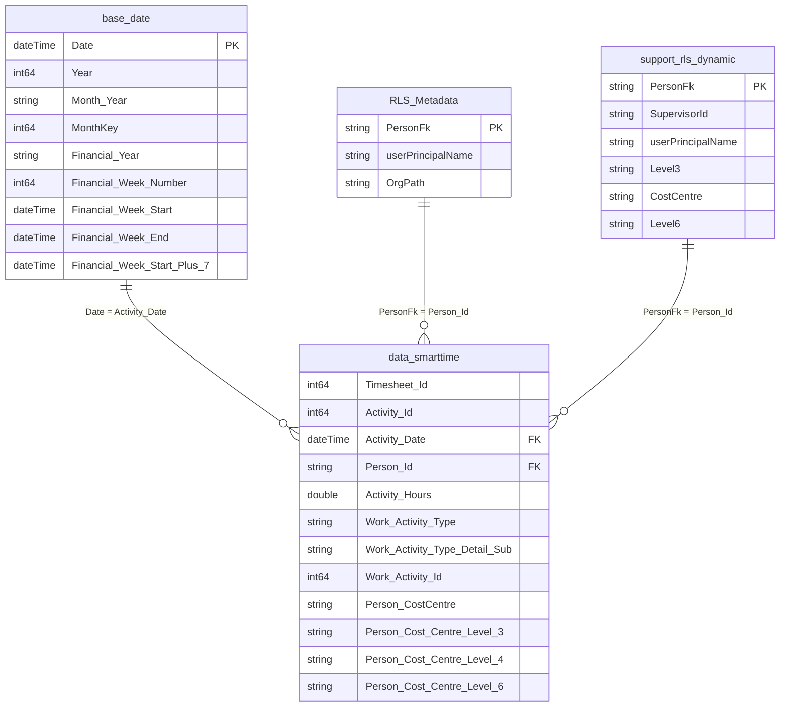

# 02 — Semantic Models, Reports & DAX Dictionary

This document covers the semantic model topology, table schemas, relationships, calculated columns, DAX measures, and the 10 Power BI report packages in this repository.

---

## 1. Hub-and-Spoke Semantic Model Topology

The repository uses a **Hub-and-Spoke** architecture in Power BI / Microsoft Fabric:

1. **Core Hub Model ([`semantic_model_smarttime.SemanticModel`](../fabric/semantic_model_smarttime.SemanticModel/definition/model.tmdl))**
   * Connects via **DirectQuery** to the `scw_corporate_data_products` Fabric Lakehouse SQL Analytics Endpoint (`6o7iqqh3u5ruxod3jwhnucnsru-h3xe24f5b4fe7h3tmfs6pskvcy.datawarehouse.fabric.microsoft.com`), plus one imported calculated table (`RLS_Metadata`).
   * Centralises all core business logic, 52 DAX measures on `data_smarttime`, calculated columns, relationships, and 6 Row-Level Security (RLS) roles.
2. **Spoke Composite Models (`DirectQuery to AS - semantic_model_smarttime`)**
   * Five operational reports and the Dynamic Structure Chart use local composite semantic models that connect live via `AnalysisServices.Database("powerbi://api.powerbi.com/v1.0/myorg/%5BDI%5D%20SCW%20Corporate%20Products", "semantic_model_smarttime")`, exposing only the subset of tables required by that specific report (`PBI_RemovedChildren`) and adding a lightweight local `0_Environment` table where needed.
3. **Thin Reports (`byPath` to `semantic_model_smarttime.SemanticModel`)**
   * [`Activity Time Recorded.Report`](../fabric/Activity%20Time%20Recorded.Report/definition.pbir) and [`Activity Time Billable_Int.Report`](../fabric/Activity%20Time%20Billable_Int.Report/definition.pbir) bind directly to `semantic_model_smarttime.SemanticModel` without a separate local `.SemanticModel` wrapper.
4. **Standalone Project View Model ([`smarttime_data_semantic_model_project_view.SemanticModel`](../fabric/smarttime_data_semantic_model_project_view.SemanticModel/definition/model.tmdl))**
   * Used by [`smartworking_operational_report_project`](../fabric/smartworking_operational_report_project.Report/definition.pbir) so Project Managers can inspect timesheet hours across their projects without being restricted by line-management/cost-centre RLS on `data_smarttime`.

---

## 2. Core Hub Model (`semantic_model_smarttime`) Schema & Relationships

### 2.1 Entity-Relationship Diagram



### 2.2 Table Inventory in `semantic_model_smarttime`

| Table Name | Storage Mode | Source / Partition | Visibility | Purpose |
| :--- | :--- | :--- | :--- | :--- |
| [`data_smarttime`](../fabric/semantic_model_smarttime.SemanticModel/definition/tables/data_smarttime.tmdl) | DirectQuery | Lakehouse `dbo.data_smarttime` | Visible | Fact table containing all SmartTime activity entries since `2024-04-01`, enriched with staff, cost centre, contract, rate, and compliance calculations. |
| [`base_date`](../fabric/semantic_model_smarttime.SemanticModel/definition/tables/base_date.tmdl) | DirectQuery | Lakehouse `dbo.base_date` | Visible | Calendar dimension (`Time` data category) with NHS financial weeks/years and working-day calculations. |
| [`base_metadata_smarttime`](../fabric/semantic_model_smarttime.SemanticModel/definition/tables/base_metadata_smarttime.tmdl) | DirectQuery | Lakehouse `dbo.base_metadata_smarttime` | Visible | Unpivoted `Attribute` / `Value` metadata for Product `P00278` (ID `404`) displayed on the Cover & Notes pages. |
| [`base_metadata_dynamic_structure_chart`](../fabric/semantic_model_smarttime.SemanticModel/definition/tables/base_metadata_dynamic_structure_chart.tmdl) | DirectQuery | Lakehouse `dbo.base_metadata_dynamic_structure_chart` | Visible | Unpivoted `Attribute` / `Value` metadata for Product `P00287` (ID `426`) displayed on the Dynamic Structure Chart Cover/Notes pages. |
| [`RLS_Metadata`](../fabric/semantic_model_smarttime.SemanticModel/definition/tables/RLS_Metadata.tmdl) | Import (Calculated) | `SELECTCOLUMNS('support_rls_hierarchy_gold', ...)` | Visible | Imported projection of `PersonFk`, `userPrincipalName`, and `OrgPath` from `support_rls_hierarchy_gold` used by the `service line` RLS role (`PATHCONTAINS`). |
| [`support_rls_hierarchy_gold`](../fabric/semantic_model_smarttime.SemanticModel/definition/tables/support_rls_hierarchy_gold.tmdl) | DirectQuery | Lakehouse `dbo.support_rls_hierarchy_gold` | Hidden | Gold hierarchy table written by the PySpark notebook (`OrgPath` + 8-level hierarchy columns `OrgPath Level 1` .. `Level 8`). Exposed as visible in `dynamic_structure_chart`. |
| [`teams_rls_static`](../fabric/semantic_model_smarttime.SemanticModel/definition/tables/teams_rls_static.tmdl) | DirectQuery | Lakehouse `dbo.teams_rls_static` | Hidden | Static Cost Centre L3 / L4 / L6 user access mapping from SharePoint `rls_static.xlsx`. |
| [`support_rls_dynamic`](../fabric/semantic_model_smarttime.SemanticModel/definition/tables/support_rls_dynamic.tmdl) | DirectQuery | Lakehouse `dbo.support_rls_dynamic` | Hidden | Active staff hierarchy joined with Entra ID UPNs. |
| [`support_rls_dynamic_missing`](../fabric/semantic_model_smarttime.SemanticModel/definition/tables/support_rls_dynamic_missing.tmdl) | DirectQuery | Lakehouse `dbo.support_rls_dynamic_missing` | Hidden | 16 manual staff hierarchy overrides/additions. |
| [`support_rls_dynamic_merged`](../fabric/semantic_model_smarttime.SemanticModel/definition/tables/support_rls_dynamic_merged.tmdl) | DirectQuery | Lakehouse `dbo.support_rls_dynamic_merged` | Hidden | Union of `support_rls_dynamic` and `support_rls_dynamic_missing`. |
| [`support_entraid_users`](../fabric/semantic_model_smarttime.SemanticModel/definition/tables/support_entraid_users.tmdl) | DirectQuery | Lakehouse `dbo.support_entraid_users` | Hidden | Microsoft Graph `/users` directory snapshot. |
| [`support_entraid_groups`](../fabric/semantic_model_smarttime.SemanticModel/definition/tables/support_entraid_groups.tmdl) | DirectQuery | Lakehouse `dbo.support_entraid_groups` | Hidden | Microsoft Graph `/groups` directory snapshot. |
| [`support_bank_holidays`](../fabric/semantic_model_smarttime.SemanticModel/definition/tables/support_bank_holidays.tmdl) | DirectQuery | Lakehouse `dbo.support_bank_holidays` | Hidden | UK bank holidays date list from `gov.uk`. |
| [`data_oracle_agency_cost_rates`](../fabric/semantic_model_smarttime.SemanticModel/definition/tables/data_oracle_agency_cost_rates.tmdl) | DirectQuery | Lakehouse `dbo.data_oracle_agency_cost_rates` | Hidden | Oracle agency hourly rates by assignment number. |
| [`data_oracle_staff_cost_exceptions`](../fabric/semantic_model_smarttime.SemanticModel/definition/tables/data_oracle_staff_cost_exceptions.tmdl) | DirectQuery | Lakehouse `dbo.data_oracle_staff_cost_exceptions` | Hidden | Oracle staff cost exception hourly rates. |

---

## 3. Calculated Columns Dictionary

### 3.1 `data_smarttime` Calculated Columns
Defined in [`semantic_model_smarttime.SemanticModel/definition/tables/data_smarttime.tmdl`](../fabric/semantic_model_smarttime.SemanticModel/definition/tables/data_smarttime.tmdl):

| Column Name | Display Folder | Formula (DAX) | Business Logic |
| :--- | :--- | :--- | :--- |
| `DailyExpectedHours` | `_Calculations\Hours` | `(data_smarttime[Person_Hours_Per_Week] / 5)` | Standard expected daily hours assuming a 5-day working week. |
| `%SmartTimeCompliance_daily` | `_Calculations\Compliance` | `DIVIDE(data_smarttime[Activity_Hours], data_smarttime[DailyExpectedHours], 0)` | Ratio of recorded activity hours to daily expected hours. |
| `calc_smarttime_days` | `_Calculations\Finance` | `data_smarttime[Activity_Hours] / 7.5` | Converts recorded hours into standard 7.5-hour NHS WTE days. |
| `calc_burn_invoiceable` | `_Calculations\Finance` | `IF(data_smarttime[Activity_Non_Invoiceable] = FALSE, [calc_smarttime_days] * data_smarttime[Day_Rate], 0)` | Monetary burn (`£`) for invoiceable activities. |
| `calc_burn_non_invoiceable` | `_Calculations\Finance` | `IF(data_smarttime[Activity_Non_Invoiceable] = TRUE, [calc_smarttime_days] * data_smarttime[Day_Rate], 0)` | Monetary burn (`£`) for non-invoiceable activities. |
| `calc_timesheet_due_by` | `_Calculations\Timesheets` | `RELATED(base_date[Financial Week Start Plus 7])` | Timesheet submission deadline (the Monday following the financial week start). |
| `calc_lateness` | `_Calculations\Timesheets` | `IF(ISBLANK(data_smarttime[Timesheet_Submitted_By_Id]), "not submitted", IF(DATEDIFF(data_smarttime[calc_timesheet_due_by], data_smarttime[Activity_Submitted_Date], DAY) > 0, "late", "on time"))` | Classifies each timesheet row as `"on time"`, `"late"`, or `"not submitted"`. |
| `calc_lateness_conditional_formatting` | `_Calculations\Timesheets` | `IF(data_smarttime[calc_lateness] = "late", 1, IF(data_smarttime[calc_lateness] = "on time", 2, IF(data_smarttime[calc_lateness] = "not submitted", 3, "check logic")))` | Numeric status code (`1` = Late, `2` = On Time, `3` = Not Submitted) for matrix icon/colour rules. |
| `person_full_name` | *(root)* | `data_smarttime[Person_FirstName] & " " & data_smarttime[Person_LastName]` | Lowercase full name. |
| `person_fullname2` | *(root)* | `data_smarttime[Person_LastName] & ", " & data_smarttime[Person_FirstName]` | `"Lastname, Firstname"` format. |
| `line_manager_full_name` | *(root)* | `data_smarttime[Line_Manager_First_Name] & " " & data_smarttime[Line_Manager_Last_Name]` | Full name of the employee's line manager. |
| `work_activity_number` | *(root)* | `"WA" & data_smarttime[Work_Activity_Id]` | Prefixes Work Activity ID with `"WA"` (e.g. `"WA7016"`). |
| `work_activity_name_wanumber` | *(root)* | `"WA" & data_smarttime[Work_Activity_Id] & " - " & data_smarttime[Work_Activity_Name]` | Combined Work Activity code and name. |
| `work_activity_name_oppnumber` | *(root)* | `IF(ISBLANK(data_smarttime[Work_Activity_Pipeline_Code]), data_smarttime[Work_Activity_Name], data_smarttime[Work_Activity_Pipeline_Code] & " - " & data_smarttime[Work_Activity_Name])` | Combined Salesforce Opportunity/Pipeline code and Work Activity name. |
| `test` | *(root)* | `DATEDIFF(data_smarttime[calc_timesheet_due_by], data_smarttime[Activity_Submitted_Date], DAY)` | Days elapsed between due date and submission date. |

### 3.2 `support_rls_hierarchy_gold` Calculated Columns
Used by **`dynamic_structure_chart`** (`P00287`) to render the interactive 8-level organisation chart:
* `OrgPath Level 1` through `OrgPath Level 8`:
  ```dax
  LOOKUPVALUE(
      support_rls_hierarchy_gold[Name],
      support_rls_hierarchy_gold[PersonFk],
      PATHITEM(support_rls_hierarchy_gold[OrgPath], <N>, TEXT)
  )
  ```
  Resolves each pipe-delimited `PersonFk` at depth `<N>` (`1..8`) in `OrgPath` to the manager's display `Name`, bundled into `OrgPath Hierarchy` (`OrgPath Level 1` $\rightarrow$ `Level 8`).

---

## 4. DAX Measures Dictionary (`semantic_model_smarttime`)

### 4.1 General & Data Freshness (`_Calculations`)
| Measure | Table | Formula | Format | Description |
| :--- | :--- | :--- | :--- | :--- |
| `calc_workingdays` | `data_smarttime` | Counts weekdays (`WEEKDAY([Date], 2) <= 5`) between `MIN(Activity_Date)` and `MAX(Activity_Date)` in `ALLSELECTED()`. | `0` | Working days in current filter context. |
| `Count_Days_in_Month` | `base_date` | `CALCULATE(DISTINCTCOUNT(base_date[Date]), base_date[Day of Week Number]<>6 && base_date[Day of Week Number]<>7)` | `0` | Working days (Mon–Fri) in the selected calendar period. |
| `calc_activity_start_date` | `data_smarttime` | `CALCULATE(MIN(data_smarttime[Activity_Date]), REMOVEFILTERS(data_smarttime[Activity_Date]))` | `General Date` | Earliest activity date ignoring date slicers. |
| `calc_smarttime_latestdate` | `data_smarttime` | `MAX(data_smarttime[Activity_Created_Date])` | `dd/mm/yyyy hh:nn` | Timestamp of the most recently created SmartTime entry. |
| `calc_smarttime_fresheness` | `data_smarttime` | `IF(DATEDIFF(TODAY(), [calc_smarttime_latestdate], DAY) > 1, "#F80101", "#78be20")` | Text (Hex) | Returns green (`#78be20`) if data is within 1 day, or red (`#F80101`) if stale. |
| `txt_smarttime_updatedat` | `data_smarttime` | `"Latest SmartTime data as at: " & [calc_smarttime_latestdate]` | Text | Banner text for Activity Time reports. |

### 4.2 Compliance & 1-to-1 Measures (`_Calculations\Compliance`)
| Measure | Formula / Logic Summary | Format | Description |
| :--- | :--- | :--- | :--- |
| `calc_compliance` | `[calc_submitted_timesheets] / [calc_timesheet_count]` | `0.00%` | Overall timesheet submission compliance rate. |
| `MonthlyExpectedHours` | `MAX(data_smarttime[DailyExpectedHours]) * [Count_Days_in_Month]` | General | Expected hours in the selected month(s). |
| `%SmartTimeCompliance` | `DIVIDE(SUM(data_smarttime[Activity_Hours]), data_smarttime[MonthlyExpectedHours], 0)` | `0.0%` | Recorded hours divided by monthly expected hours. |
| `calc_121_compliance_ActiveStaff` | Cross-joins `VALUES(data_smarttime[Person_Id])` and `VALUES(base_date[Month Year])`.<br/>• **Denominator (`expected_121`):** Active `(Person, Month)` pairs with `COUNTROWS(data_smarttime) > 0`.<br/>• **Numerator (`received_121`):** Active `(Person, Month)` pairs with at least one entry where **`Work_Activity_Id = 7016`** (1-to-1 meeting activity).<br/>• Returns `DIVIDE(received_121, expected_121)`. | `0%` | Percentage of active person-months with a recorded 1:1 (`WA7016`). |
| `calc_121_compliance_ActiveStaff_cond_tickmark` | Same calculation as `calc_121_compliance_ActiveStaff`, but returns `UNICHAR(10003)` (`✓`) when `>= 1` (`100%`), otherwise the percentage. | `0%` | Displays a checkmark `✓` in matrices when 1:1 compliance is met for the month. |

### 4.3 Timesheets & Hours Measures (`_Calculations\Timesheets` & `_Calculations\Hours`)
| Measure | Formula | Format | Description |
| :--- | :--- | :--- | :--- |
| `calc_timesheet_count` | `DISTINCTCOUNT(data_smarttime[Timesheet_Id])` | `0` | Total distinct timesheets (submitted + unsubmitted). |
| `calc_submitted_timesheets` | `IF(ISBLANK(MAX(data_smarttime[Timesheet_Submitted_By_Id])), 0, CALCULATE([calc_timesheet_count], NOT(ISBLANK(data_smarttime[Timesheet_Submitted_By_Id]))))` | `0` | Distinct timesheets that have been submitted. |
| `calc_unsubmitted_timesheets` | `[calc_timesheet_count] - [calc_submitted_timesheets]` | `0` | Distinct timesheets not yet submitted. |
| `calc_submitted_timesheets_%` | `[calc_submitted_timesheets] / [calc_timesheet_count]` | `0.00%` | Share of timesheets submitted. |
| `calc_unsubmitted_timesheets_%` | `[calc_unsubmitted_timesheets] / [calc_timesheet_count]` | `0.00%` | Share of timesheets unsubmitted. |
| `calc_late_timesheets` | `CALCULATE([calc_submitted_timesheets], data_smarttime[calc_lateness] = "late")` | `0` | Submitted timesheets submitted after `calc_timesheet_due_by`. |
| `calc_late_timesheets_%` | `[calc_late_timesheets] / (DISTINCTCOUNT(base_date[Financial Week Start]) * DISTINCTCOUNT(data_smarttime[Person_Id]))` | `0.00%` | Late timesheets as a percentage of person-weeks. |
| `calc_timesheet_expected_hours` | Computes `(DATEDIFF(StartDate, MIN(SlicerEndDate, TODAY()), DAY) + 1) / 7.0 * MIN(data_smarttime[Person_Hours_Per_Week])` if period has started. | General | Pro-rata expected hours up to `TODAY()`. |
| `calc_total_activity_hours` | `SUM(data_smarttime[Activity_Hours])` | General | Total recorded hours (submitted + unsubmitted). |
| `calc_submitted_hours` | `CALCULATE([calc_total_activity_hours], data_smarttime[calc_lateness] = "late" \|\| data_smarttime[calc_lateness] = "on time")` | General | Total hours on submitted timesheets. |
| `calc_unsubmitted_hours` | `CALCULATE([calc_timesheet_expected_hours] - [calc_submitted_hours])` | General | Gap between expected hours and submitted hours. |
| `calc_submitted_hours_%` | `[calc_submitted_hours] / [calc_total_activity_hours]` | `0.00%` | Submitted hours divided by total recorded hours. |
| `calc_unsubmitted_hours_%` | `[calc_unsubmitted_hours] / [calc_total_activity_hours]` | `0.00%` | Unsubmitted hours divided by total recorded hours. |

### 4.4 Finance & Utilisation Category Measures (`_Calculations\Finance`)
All utilisation category percentages divide the category hours by **`[calc_contractedhours minus calc_NonWorkingHours]`** (net available working hours after deducting annual leave/sickness/non-working time):

| Measure | Filter Condition on `data_smarttime` | Companion `%` Measure |
| :--- | :--- | :--- |
| `calc_contractedhours` | `(AVERAGE(data_smarttime[Person_Hours_Per_Week]) / 5) * [calc_workingdays]` | N/A |
| `calc_NonWorkingHours` | `Work_Activity_Type = "Non-Working"` | N/A |
| `calc_contractedhours minus calc_NonWorkingHours` | `[calc_contractedhours] - [calc_NonWorkingHours]` | Denominator for all utilisation `%` measures |
| `Activity_Hours minus calc_contractedhours 2` | `SUM('data_smarttime'[Activity_Hours]) - [calc_contractedhours]` | Variance between recorded and contracted hours |
| `calc_BillableHours` | `Work_Activity_Type = "Billable"` | `calc_BillableHours divided by calc_contractedhours minus calc_NonWorkingHours` |
| `calc_CORE BAU Hours` | `Work_Activity_Type_Detail_Sub = "CORE BAU"` | `calc_CORE BAU Hours divided by calc_contractedhours minus calc_NonWorkingHours` |
| `calc_CORE DisccretionaryHours` | `Work_Activity_Type_Detail_Sub = "CORE Discretionary"` | `calc_CORE DisccretionaryHours divided by calc_contractedhours minus calc_NonWorkingHours` |
| `calc_PipeLine Project Hours` | `Work_Activity_Type_Detail_Sub = "Pipeline Project"` | `calc_PipeLine Project Hours divided by calc_contractedhours minus calc_NonWorkingHours` |
| `calc_Int SLA Hours` | `Work_Activity_Type = "Internal SLA"` | `calc_Int SLA Hours divided by calc_contractedhours minus calc_NonWorkingHours` |
| `calc_Int Serv Mgmt Hours` | `Work_Activity_Type = "Internal Service Management"` | `calc_Int Serv Mgmt Hours divided by calc_contractedhours minus calc_NonWorkingHours` |
| `calc_Non-Charge Hours` | `Work_Activity_Type = "Non-Chargeable"` | `calc_Non-Charge Hours divided by calc_contractedhours minus calc_NonWorkingHours` |
| `calc_App Inv Hours` | `Work_Activity_Type = "Approved Investment"` | `calc_App Inv Hours divided by calc_contractedhours minus calc_NonWorkingHours` |
| `calc_Win WorkHours` | `Work_Activity_Type = "Winning Work"` | `calc_Win WorkHours divided by calc_contractedhours minus calc_NonWorkingHours` |
| `calc_Prod DevHours` | `Work_Activity_Type = "Product Devlopment"` *(note spelling in source data)* | `calc_Prod DevHours divided by calc_contractedhours minus calc_NonWorkingHours` |
| `calc_Acct MgmtHours` | `Work_Activity_Type = "Account Management"` | `calc_Acct MgmtHours divided by calc_contractedhours minus calc_NonWorkingHours` |
| `calc_smarttime_days_invoiceable` | `SUM(calc_smarttime_days)` where `Activity_Non_Invoiceable = FALSE` | Format: `0.00` |
| `calc_smarttime_days_non_invoiceable` | `SUM(calc_smarttime_days)` where `Activity_Non_Invoiceable = TRUE` | Format: `#,0.00` |
| `calc_rate2` | `SUM(data_smarttime[calc_burn_invoiceable]) + SUM(data_smarttime[calc_burn_non_invoiceable])` | Format: `"£"#,0.00` |

*(Note: `smartworking_operational_report_directorate_costcentre`, `_line_manager`, and `_utilisation` also define 9 additional category measures on their composite models: `calc_Covid-19Hours`, `calc_D&THours`, `calc_Dev DirectHours`, `calc_Int ConsultHours`, `calc_L&DHours`, `calc_LeaveHours`, `calc_Qual/RiskHours`, `calc_Sal SupportHours`, and `calc_Sys OversHours`, plus their `divided by calc_contractedhours minus calc_NonWorkingHours` counterparts.)*

---

## 5. Power BI Report Packages Inventory

| PBIP File | Backing Semantic Model | Visible Pages | Hidden Tooltip / Drillthrough Pages | Purpose |
| :--- | :--- | :--- | :--- | :--- |
| [`dynamic_structure_chart.pbip`](../fabric/dynamic_structure_chart.pbip) | `dynamic_structure_chart.SemanticModel` (Composite $\rightarrow$ `semantic_model_smarttime`) | • `Cover`<br/>• `Notes`<br/>• `Hierarchy Chart`<br/>• `Page 1` | *(none)* | **P00287:** Interactive organisation chart (`OrgPath Level 1..8`) showing line management across SCW. |
| [`smartworking_operational_report_cover.pbip`](../fabric/smartworking_operational_report_cover.pbip) | `smartworking_operational_report_cover.SemanticModel` (Composite $\rightarrow$ `semantic_model_smarttime`) | • `Cover`<br/>• `Notes` | *(none)* | **P00278 Landing Page:** Displays product metadata from SharePoint (`ID = 404`) and navigation guidance. |
| [`smartworking_operational_report_121_compliance.pbip`](../fabric/smartworking_operational_report_121_compliance.pbip) | `smartworking_operational_report_121_compliance.SemanticModel` (Composite $\rightarrow$ `semantic_model_smarttime`) | • `1:1 Compliance` | *(none)* | **P00278 1:1 Compliance View:** Tracks monthly 1-to-1 meeting completion (`Work_Activity_Id = 7016`) across active staff. |
| [`smartworking_operational_report_directorate_costcentre.pbip`](../fabric/smartworking_operational_report_directorate_costcentre.pbip) | `smartworking_operational_report_directorate_costcentre.SemanticModel` (Composite $\rightarrow$ `semantic_model_smarttime`) | • `Directorate/Cost Centre` | • `tt_cost_centre` (Tooltip) | **P00278 Directorate & Cost Centre View:** High-level timesheet submission, lateness, and hours compliance by L3/L4/L6 Cost Centre. |
| [`smartworking_operational_report_line_manager.pbip`](../fabric/smartworking_operational_report_line_manager.pbip) | `smartworking_operational_report_line_manager.SemanticModel` (Composite $\rightarrow$ `semantic_model_smarttime`) | • `Line Manager` | • `tt_person` (Tooltip)<br/>• `Page 1`, `Page 2` | **P00278 Line Manager View:** Allows managers to monitor their direct/indirect reports' timesheet submissions and lateness. |
| [`smartworking_operational_report_project.pbip`](../fabric/smartworking_operational_report_project.pbip) | `smartworking_operational_report_project.SemanticModel` (Composite $\rightarrow$ `smarttime_data_semantic_model_project_view`) | • `Project` | • `tt_timesheets` (Tooltip) | **P00278 Project View:** Tracks hours, burn, and timesheet submissions by Work Activity / Pipeline Code / Verto project without line-manager RLS filtering. |
| [`smartworking_operational_report_utilisation.pbip`](../fabric/smartworking_operational_report_utilisation.pbip) | `smartworking_operational_report_utilisation.SemanticModel` (Composite $\rightarrow$ `semantic_model_smarttime`) | • `Utilisation Dashboard` | • `dt_individuals` (Drillthrough)<br/>• `tt_timesheets` (Tooltip) | **P00278 Utilisation View:** Breaks down staff time across Billable, CORE BAU, Discretionary, Pipeline, SLA, and Non-Chargeable categories with individual drillthrough. |
| [`Activity Time Recorded.pbip`](../fabric/Activity%20Time%20Recorded.pbip) | `semantic_model_smarttime.SemanticModel` (Direct `byPath`) | • `Activity time recorded (w/ comments)` | *(none)* | Detailed line-level table and 26 slicers showing all recorded activity rows, rates, costs, and free-text comments. |
| [`Activity Time Billable_Int.pbip`](../fabric/Activity%20Time%20Billable_Int.pbip) | `semantic_model_smarttime.SemanticModel` (Direct `byPath`) | • `Activity time recorded (w/ comments)` | *(none)* | Same layout as `Activity Time Recorded`, pre-filtered on the page to Billable and Internal SLA/Service Management work activity types. |
| [`semantic_model_smarttime.pbip`](../fabric/semantic_model_smarttime.pbip) & [`smarttime_data_semantic_model_project_view.pbip`](../fabric/smarttime_data_semantic_model_project_view.pbip) | Local `.SemanticModel` |Scratch/test pages (hidden) | *(none)* | Authoring containers used to open and edit the two hub semantic models in Power BI Desktop. |
