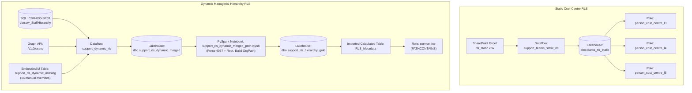

# 03 — Security & Row-Level Security (RLS) Guide

This document explains how **Row-Level Security (RLS)** and organisational hierarchy resolution work across the Fabric Dataflows, PySpark Notebook, and `semantic_model_smarttime`.

---

## 1. Overview of the Dual RLS Architecture

`semantic_model_smarttime` implements two complementary RLS mechanisms:
1. **Static Cost-Centre RLS (`teams_rls_static`)** — Grants users access to specific Directorate (`Level 3`), Service Line (`Level 4`), or Cost Centre (`Level 6` / `CostCentre`) slices based on an Excel workbook (`rls_static.xlsx`) maintained in Teams/SharePoint.
2. **Dynamic Managerial Hierarchy RLS (`RLS_Metadata` / `support_rls_hierarchy_gold`)** — Automatically grants line managers access to their own records and everyone in their downward reporting chain (up to 15 levels deep) using `PATHCONTAINS` against the `OrgPath` built by the PySpark notebook.



---

## 2. RLS Roles Defined in `semantic_model_smarttime`

All role definitions live under [`semantic_model_smarttime.SemanticModel/definition/roles/`](../fabric/semantic_model_smarttime.SemanticModel/definition/roles/):

| Role Name | TMDL File | Filtered Table | DAX Filter Expression | Purpose & Assignment |
| :--- | :--- | :--- | :--- | :--- |
| **`person_cost_centre_l3`** | [`person_cost_centre_l3.tmdl`](../fabric/semantic_model_smarttime.SemanticModel/definition/roles/person_cost_centre_l3.tmdl) | `data_smarttime` | `[Person_Cost_Centre_Level_3] IN CALCULATETABLE(VALUES('teams_rls_static'[Access Level3]), teams_rls_static[scwcsu email] = USERPRINCIPALNAME())` | Grants Directorate-level (L3) access based on `rls_static.xlsx`. |
| **`person_cost_centre_l4`** | [`person_cost_centre_l4.tmdl`](../fabric/semantic_model_smarttime.SemanticModel/definition/roles/person_cost_centre_l4.tmdl) | `data_smarttime` | `[Person_Cost_Centre_Level_3] IN CALCULATETABLE(VALUES('teams_rls_static'[Access L4]), teams_rls_static[scwcsu email] = USERPRINCIPALNAME())` | Grants L4 access based on `rls_static.xlsx`. *(Note: currently compares `[Person_Cost_Centre_Level_3]` against `[Access L4]`—verify if L4 column matching is needed).* |
| **`person_cost_centre_l6`** | [`person_cost_centre_l6.tmdl`](../fabric/semantic_model_smarttime.SemanticModel/definition/roles/person_cost_centre_l6.tmdl) | `data_smarttime` | `[Person_CostCentre] IN CALCULATETABLE(VALUES(teams_rls_static[Access CostCentre]), teams_rls_static[scwcsu email] = USERPRINCIPALNAME())` | Grants Cost-Centre code (`Person_CostCentre`) access based on `rls_static.xlsx`. |
| **`service line`** | [`service line.tmdl`](../fabric/semantic_model_smarttime.SemanticModel/definition/roles/service%20line.tmdl) | `RLS_Metadata` ($\rightarrow$ filters `data_smarttime` via `PersonFk = Person_Id`) | `VAR CurrentUserEmail = USERPRINCIPALNAME()`<br/>`VAR LoggedInEmployeeID = LOOKUPVALUE('RLS_Metadata'[PersonFk], 'RLS_Metadata'[userPrincipalName], CurrentUserEmail)`<br/>`RETURN PATHCONTAINS('RLS_Metadata'[OrgPath], LoggedInEmployeeID)` | **Dynamic Line Manager RLS:** Filters `RLS_Metadata` (and `data_smarttime`) to any staff member whose `OrgPath` contains the logged-in user's `PersonFk`. |
| **`project`** | [`project.tmdl`](../fabric/semantic_model_smarttime.SemanticModel/definition/roles/project.tmdl) | *(No table filter)* | Unfiltered read (`modelPermission: read`) | Assigned to Project Managers requiring cross-organisation visibility for project tracking. |
| **`utilisation`** | [`utilisation.tmdl`](../fabric/semantic_model_smarttime.SemanticModel/definition/roles/utilisation.tmdl) | *(No table filter)* | Unfiltered read (`modelPermission: read`) | Assigned to Utilisation / Operations leads requiring full organisation visibility. |

---

## 3. Static RLS Maintenance (`rls_static.xlsx`)

* **Location:** SharePoint site `https://nhs.sharepoint.com/sites/msteams_7026cb-P00278SmartTimeDataQualityReporting/`
* **Folder Path:** `Shared Documents/P00278 SmartTime Data Quality Reporting/Supporting Docs/rls_static.xlsx`
* **Worksheet Name:** `rls_static`
* **Expected Columns:**
  `Access CostCentre`, `Access Level3`, `Access L4`, `Access Level6`, `PersonFk`, `NameFirst`, `NameLast`, `Email`, `supervisorId`, `supervisor`, `Id`, `scwcsu email`, `full_name`, `pg group`
* **How to Apply Changes:**
  1. Edit `rls_static.xlsx` in SharePoint/Teams (ensure `scwcsu email` matches the user's Power BI `USERPRINCIPALNAME()`, e.g., `firstname.lastname@scwcsu.nhs.uk` or `@nhs.net` depending on Entra UPN).
  2. Trigger the on-demand Fabric Pipeline **`static_rls_update (on demand)`** in workspace `[DI] SCW Corporate Products`.

---

## 4. Dynamic RLS, Hierarchy Safeguards & Hardcoded Business Rules

### 4.1 Deterministic Hierarchy Engine & Safeguards (`support_rls_dynamic_merged_path.ipynb`)
In [`notebooks/support_rls_dynamic_merged_path.ipynb`](../notebooks/support_rls_dynamic_merged_path.ipynb), `resolve_staff_hierarchy()` builds `support_rls_hierarchy_gold` with five built-in safeguards so active staff **never** scatter into disconnected islands on the Org Chart:
1. **Root Integrity & Explicit Manual Overrides:** Forces `PersonFk == "4037"` (Managing Director) to `SupervisorId = None` (`Leaver = 0`) and applies the 16 explicit supervisor overrides defined in `MANUAL_SUPERVISOR_OVERRIDES` directly in version-controlled Python.
2. **Leaver Path Compression (`Bridged via Leaver`):** `dataflows/support_dynamic_rls.pq` retains `Leaver = 1` records (sorted so `Leaver = 0` takes priority on deduplication). When an active employee reports to a departed line manager (`Leaver = 1`), the notebook walks up the supervisory chain and compresses the link directly to their nearest **active** ancestor (`Leaver = 0`), recording the original raw manager in `OriginalSupervisorId` and tagging `HierarchyStatus = "Bridged via Leaver"`.
3. **Token-Safe Cycle Detection (`Cycle Repaired`):** Uses exact set membership (`visited`) rather than substring `.contains()` (preventing false collisions like `"403"` inside `"4037"`) and breaks any supervisory loops deterministically.
4. **Tiered Org-Unit Lead Fallback:** Any remaining disconnected subtree root is attached to the shallowest-depth connected active supervisor in its:
   * **Tier 1:** `Level6` (`Fallback: Level6 Lead`)
   * **Tier 2:** `CostCentre` (`Fallback: CostCentre Lead`)
   * **Tier 3:** `Level3` Directorate (`Fallback: Level3 Lead`)
   * **Tier 4:** Root `4037` (`Fallback: Root (4037)`)
   Intact teams under an orphaned manager stay grouped under their manager while the manager is attached to the unit lead.
5. **Audit & Metric Columns Added to `support_rls_hierarchy_gold`:**
   * `SupervisorId` — Repaired active manager ID (guaranteed single tree rooted at `4037`).
   * `OriginalSupervisorId` — Raw unmodified `SupervisorId` from ESR/SmartTime for data-quality auditing.
   * `HierarchyStatus` — Resolution status (`Root`, `Direct`, `Manual Override`, `Bridged via Leaver`, `Fallback: Level6 Lead`, `Fallback: CostCentre Lead`, `Fallback: Level3 Lead`, `Fallback: Root (4037)`, `Cycle Repaired`).
   * `HierarchyDepth` — 1-based depth from `4037`.
   * `DirectReportsCount` & `TotalReportsCount` — Precomputed active direct and total subtree report counts.
   * **Custom Visual (`visuals/scw-org-chart/`):** The in-house [`scwOrgChart` Power BI Custom Visual](../visuals/scw-org-chart/README.md) consumes these columns to provide instant search, path auto-expansion, pan/zoom, cross-filtering, and toggleable `⚡` Hierarchy Health Badges.

### 4.2 Why `PersonFk <> "3207"` is Excluded in `support_rls_dynamic`
In [`dataflows/support_dynamic_rls.pq`](../dataflows/support_dynamic_rls.pq):
```powerquery
#"Filtered rows 1" = Table.SelectRows(#"Removed Duplicates", each [PersonFk] <> "3207")
```
* `PersonFk = 3207` (**Steven Aulman**) has an incorrect or missing supervisor mapping in `dbo.vw_StaffHierarchy` on `CSU-000-SP03`.
* He is excluded from `support_rls_dynamic` so that his corrected record in `support_rls_dynamic_missing` takes precedence when the two tables are combined in `support_rls_dynamic_merged`.

### 4.3 Full Decoded Contents of `support_rls_dynamic_missing`
The query `support_rls_dynamic_missing` in [`dataflows/support_dynamic_rls.pq`](../dataflows/support_dynamic_rls.pq) stores 16 hardcoded staff records inside a compressed Base64 `Binary.FromText(...)` payload to bridge missing supervisor links in `vw_StaffHierarchy`. For transparency, here are the exact 16 rows decoded from that binary payload:

| PersonFk | NameFirst | NameLast | SupervisorId | Supervisor | Level3 | CostCentre | Level6 | Email / UPN |
| :--- | :--- | :--- | :--- | :--- | :--- | :--- | :--- | :--- |
| `5961` | Michael | Dunne | `324` | Nicole Sumerhill | `unknown` | | `unknown` | |
| `2854` | David | Rowlands | `3122` | Linday Lipett | `unknown` | | `unknown` | |
| `6112` | Kait | Harvey | `2904` | Heather Muldoon | `unknown` | | `unknown` | |
| `6980` | Laura | Davy | `2876` | Laura Davy | `unknown` | | `unknown` | |
| `3252` | Wendy | Marshall | `4874` | John O'Connell | `unknown` | | `unknown` | |
| `6688` | Robert | Pollard | `6656` | Emma Huthart | `unknown` | | `unknown` | |
| `6678` | Andrew | Lang | `8779` | Noloyiso Xuba | `unknown` | | `unknown` | |
| `6695` | Elizabeth | Lawrence | `6686` | Pippa Green | `unknown` | | `unknown` | |
| `6656` | Emma | Huthart | `5581` | Nicholas Rogers | `unknown` | | `unknown` | |
| `6686` | Pippa | Green | `8779` | Noloyiso Xuba | `unknown` | | `unknown` | |
| `5581` | Nicholas | Rogers | `6751` | Deborah Haith | `unknown` | | `unknown` | |
| `6751` | Deborah | Haith | `6935` | Alex Evans | `unknown` | | `unknown` | |
| `8178` | Ashdown | Ashdown | `6751` | Deborah Haith | `unknown` | | `unknown` | |
| `8779` | Noloyiso | Xuba | `6935` | Alex Evans | `unknown` | | `unknown` | |
| `8752` | Bex | Guy | `8404` | Matthew Tucker | `Integrated Health & Care Services` | | `ISP - IHS - Q` | |
| `3207` | Steven | Aulman | `4754` | Simon Sturgeon | `Digital Data & Technology` | `19D642` | `DDaT SLT` | `steven.aulman@nhs.net` / `steven.aulman@scwcsu.nhs.uk` |

> [!TIP]
> **Future Improvement Recommendation:** Rather than editing the compressed `Table.FromRows` step inside the Power Query editor for `support_rls_dynamic_missing`, consider moving these manual hierarchy overrides into a dedicated tab in `rls_static.xlsx` on SharePoint so non-developers can maintain missing supervisor links without editing Dataflow M code.
